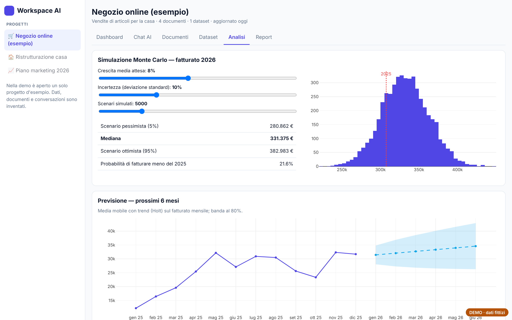

# Workspace AI

Spazio di lavoro unico per progetti, documenti, chat AI con citazioni, dataset, analisi, machine learning, previsioni, simulazioni e report: una sola PWA che si installa su PC e iPhone, con dati condivisi su un server centrale.

**[Prova la demo](https://andreapollastrelli95.github.io/workspace-ai-demo/)** · un progetto d'esempio con dashboard, chat con fonti, dataset, simulazione Monte Carlo e report. Tutti i dati sono fittizi.



Un solo frontend React responsive (installabile come app), un backend FastAPI centrale e un database PostgreSQL + pgvector condiviso. PC e iPhone vedono gli stessi progetti, documenti, chat, dataset, analisi, modelli, previsioni e report.

## Architettura

```
 iPhone (Safari → Home)  ┐
                         ├──HTTPS──▶  FastAPI (Docker su Render)  ──▶  PostgreSQL + pgvector (Neon)
 PC (Edge → Installa)    ┘             ├─ serve la PWA compilata          └─ dati, file, embedding
                                       ├─ Gemini API (chiave solo qui)
                                       └─ pandas / scikit-learn / statsmodels / Plotly
```

| Livello | Tecnologia |
|---|---|
| Frontend | React 18, TypeScript, Vite, Tailwind CSS, vite-plugin-pwa (Workbox), Plotly.js (caricato su richiesta) |
| Backend | Python 3.12, FastAPI, SQLAlchemy 2, JWT + bcrypt |
| Database | PostgreSQL 16 + pgvector (ricerca semantica sui documenti) |
| AI | Gemini (chat RAG con citazioni, OCR di foto/PDF scansionati, spiegazioni, report) |
| Analisi | pandas, scikit-learn (Random Forest / lineare / logistica), statsmodels (Holt-Winters), Monte Carlo NumPy, Plotly |

Tutti i calcoli pesanti e tutte le chiamate a Gemini avvengono sul server: il browser riceve solo i risultati e i grafici (JSON Plotly).

## Struttura

```
backend/app/
  main.py        API: auth, progetti, documenti, chat, dataset, analisi, report + serve la PWA
  models.py      tabelle (users, projects, documents, chunks[vector], conversations, messages, datasets, analyses, reports)
  gemini.py      generazione, OCR multimodale, embedding
  extract.py     estrazione testo da PDF/Word/Excel/CSV/immagini
  analytics.py   statistiche, grafici, ML, forecasting, simulazioni
frontend/src/
  App.tsx        login, layout (sidebar PC / tab bar iPhone), elenco progetti
  pages/ProjectTabs.tsx   Dashboard, Chat AI, Documenti, Dataset, Analisi, Report
  components/    UI, grafici Plotly, banner offline/aggiornamenti
frontend/public/ icone, apple-touch-icon, splash screen iPhone
Dockerfile, docker-compose.yml, render.yaml, .env.example
```

## Sviluppo locale

```bash
cp .env.example .env            # inserisci GEMINI_API_KEY
docker compose up --build       # → http://localhost:8000
```
Oppure senza Docker: avvia Postgres con pgvector, poi `cd backend && pip install -r requirements.txt && uvicorn app.main:app --reload` e in un altro terminale `cd frontend && npm install && npm run dev` (→ http://localhost:5173, le chiamate /api vanno al backend).

## Pubblicazione gratuita (consigliata)

1. **Database — Neon** (piano Free permanente, pgvector incluso): crea un progetto in regione Frankfurt, copia la *connection string*.
2. **Codice — GitHub**: crea un repository con questo codice.
3. **Server — Render**: New → Blueprint → scegli il repository (legge `render.yaml`). Inserisci `DATABASE_URL` (Neon) e `GEMINI_API_KEY`. Dopo il deploy ottieni `https://<nome-servizio>.onrender.com` (o simile).
4. Apri l'URL, crea il tuo account, poi in Render imposta `ALLOW_SIGNUP=false`.
5. **Dominio personalizzato** (facoltativo): Render → Settings → Custom Domains → aggiungi `app.tuodominio.it`, poi nel DNS del dominio crea il record `CNAME app → <nome-servizio>.onrender.com`. Il certificato HTTPS è automatico.

Limiti del gratuito da conoscere: il server Render si addormenta dopo 15 minuti senza visite e il primo accesso successivo impiega circa un minuto (con un piano a pagamento il problema sparisce). Neon Free offre 1 GB per progetto: i file sono salvati nel database, quindi tienili sotto i 20 MB l'uno.

**Alternativa “a PC acceso”**: lo stesso `docker compose` gira sul PC di casa ed è pubblicabile in HTTPS con Cloudflare Tunnel; ma in quel caso l'app non funziona a PC spento.

## Note di sicurezza

- La chiave Gemini esiste solo come variabile d'ambiente sul server.
- Password con bcrypt, sessione JWT (30 giorni) salvata sul dispositivo.
- Registrazione chiudibile con `ALLOW_SIGNUP=false`.
- Con il piano gratuito di Gemini, Google può usare i contenuti inviati per migliorare i suoi modelli: per documenti riservati (fiscali, personali) valuta di attivare la fatturazione su Google AI Studio.

## API principali

`POST /api/auth/register|login` · `GET/POST /api/projects` · `POST /api/projects/{id}/documents` (multi-file) · `POST /api/projects/{id}/conversations/{cid}/messages` · `POST /api/projects/{id}/datasets` · `POST /api/projects/{id}/analyses` (`kind`: explore, chart, forecast, model, simulation) · `POST /api/projects/{id}/reports` · documentazione interattiva su `/docs`.

---

Progetto di [Andrea Pollastrelli](https://andreapollastrelli95.github.io/).
